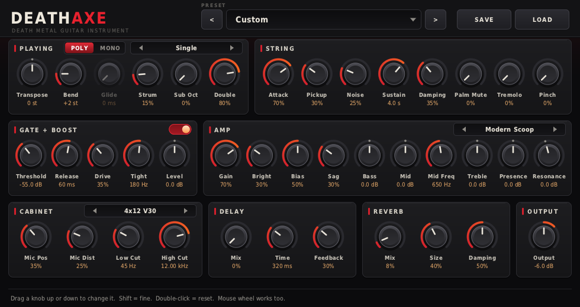
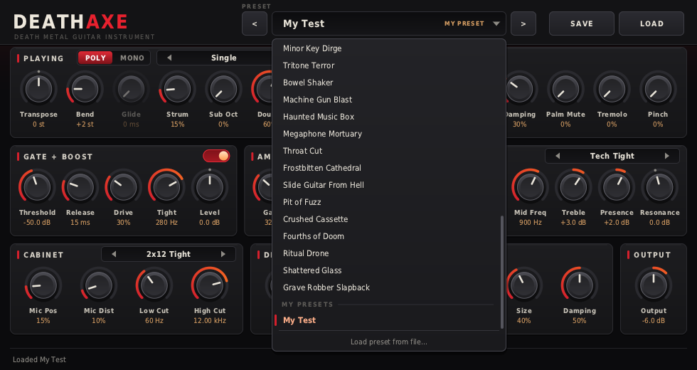

# DeathAxe

**A death metal guitar instrument plug-in (VST3) with its own editor, 40 factory presets and your own preset library.**

Play it with MIDI. DeathAxe models a real electric guitar string (pick, pickup, palm muting, tremolo picking, pinch harmonics, legato slides),
then runs it through a full high-gain chain: noise gate → boost pedal → 3-4 stage preamp → tone stack → power-amp sag → speaker cab + mic → delay → reverb.
No samples, no audio input needed.



## Download

**[Download DeathAxe.vst3](https://github.com/atruenut/DeathAxe/raw/main/prebuilt/win64/DeathAxe.vst3)** (also browsable at [prebuilt/win64](https://github.com/atruenut/DeathAxe/tree/main/prebuilt/win64)) - Windows 64-bit VST3 (a normal DLL with a `.vst3` extension, about 1.4 MB, no installer, no extra runtimes).

SHA-256: `1a71049e5d01dc457cf477f26b77c4f28934434b324b4b2b4e8518c5cd02f37e`

### Install (Windows)
1. Copy `DeathAxe.vst3` into `C:\Program Files\Common Files\VST3\` (needs admin rights).
2. Rescan plug-ins in your DAW.
3. Load **DeathAxe** on an **instrument** track (not an audio track) and send it MIDI notes.
4. Pick a preset from the preset bar at the top of the plug-in, and play.

> **Status:** the DSP, the VST3 wrapper and the editor logic are tested (see below), but I have had no Windows machine to run the plug-in window or load it in a real DAW. If anything misbehaves, please open an issue with your DAW name and version.

## Using it

* **Knobs:** drag up/down, hold **Shift** for fine control, **double-click** to reset, mouse wheel also works. Hover over anything for a plain-language explanation in the bar at the bottom.
* **Layout follows the signal path:** Playing → String → Gate + Boost → Amp → Cabinet → Delay → Reverb → Output.
* **Preset bar:** click the name for the list (factory presets, then *My Presets*), `<` `>` step through, **SAVE** stores your sound as a `.daxe` file via a normal Save dialog, **LOAD** opens any `.daxe` file. Hover one of your presets in the list and click the **x** to delete it. "(modified)" appears when you move a knob after loading a preset.
* **Playing tips:** the mod wheel adds palm mute, velocity 120+ triggers pinch harmonics (turn up *Pinch*), *Tremolo* re-picks held notes, *Mono* mode slurs overlapping notes like hammer-ons, *Chord* turns single notes into power chords and more.



Your presets live in plain-text files:

| System | Folder |
|---|---|
| Windows | `%APPDATA%\DeathAxe\Presets` |
| macOS | `~/Library/Application Support/DeathAxe/Presets` |
| Linux | `~/.config/DeathAxe/Presets` |

Copy them to share or back up; they are easy to edit by hand.

## Documentation

* **[GUIDE.md](GUIDE.md)** - the in-depth guide: how it works, playing techniques, every preset, saving presets, a worked example, troubleshooting, full parameter reference.
* [docs/presets.md](docs/presets.md) and [docs/params.md](docs/params.md) - generated tables of all presets and parameters.

## Build it yourself

| Target | How |
|---|---|
| Windows (on Windows) | Install MinGW-w64 (MSYS2 or winlibs), then run `build.bat`. It clones the VST3 SDK on first run. `build.bat install` copies the result to the VST3 folder (run as Administrator). |
| Windows or Linux (from Linux/macOS) | `pip install ziglang`, then `./tools/build_cross.sh win64` (or `linux64`). Output goes to `dist/<target>/`. Needs the VST3 SDK at `./vst3sdk` or `$VST3_SDK_ROOT`. |
| CMake (macOS / Linux / Visual Studio) | `cmake -S . -B build -DVST3_SDK_ROOT=/path/to/vst3sdk && cmake --build build --config Release` |
| Offline test renders (no SDK) | `g++ -std=c++17 -O2 tools/render.cpp -o render && ./render --all` writes WAVs to `renders/` |

The DSP core (`src/engine.h` and friends) is plain C++17 with no platform dependencies. The editor is a portable software renderer; only `src/ui/win32_window.h` is Windows-specific, so on other systems the host shows its generic parameter panel for now.

## What was tested

* The Windows DLL is a valid x64 PE exporting `GetPluginFactory`, `InitDll`, `ExitDll`, importing only built-in Windows system DLLs.
* The same plug-in code built natively for Linux passes **all 47 tests of Steinberg's official VST3 validator**.
* Logic tests drive the real controller and processor classes; a headless UI test simulates mouse input (knob drag and reset, preset list, save, load, delete) and renders screenshots at 1x and 2x.
* A randomized stress test (extreme parameters, random MIDI, 44.1/48/96 kHz) runs clean under AddressSanitizer and UBSan with no NaN/Inf output.
* **Not tested:** the Windows editor window and file dialogs at runtime, loading in a real DAW, `build.bat` on Windows, the macOS CMake path, and the sound by ear (levels, spectra and clipping were analysed only).

## Project layout

```
src/params.h        parameter table (names, ranges, defaults)
src/presets.h       the 40 factory presets
src/userpresets.h   your presets: one .daxe text file each
src/dsp_*.h         string model, amp/cab, effects, filters
src/engine.h        the instrument engine
src/ui/             editor: software renderer, widgets, layout, Win32 window
src/vst3/           VST3 wrapper (processor, controller, factory)
tools/              offline renderer, stress/logic/preset/UI tests, doc generator, cross-compile script
prebuilt/win64/     ready-to-use Windows build
```

## Licence

No licence has been chosen for this project yet, so by default all rights are reserved; add a `LICENSE` file to decide. Third-party components are listed in [THIRD_PARTY.md](THIRD_PARTY.md). The vendor name in `src/vst3/deathaxe_vst3.cpp` is plain "DeathAxe".
